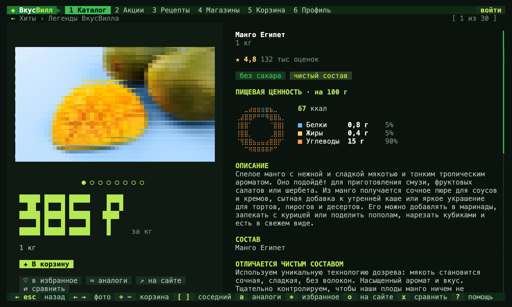

# vkusvill

[Русский](README.md) · **English**



An experimental VkusVill client for the terminal — one example of the wide range of possibilities of the [official VkusVill MCP server](https://github.com/vkustech/vkusvill-mcp-server-manifest), which opens up new formats of interaction and personalisation.

Text graphics on top of MCP: the catalog, deals, recipes, shops and a cart you check out on your phone by scanning a QR code, and once you sign in, your order history, favourite product and personal offers.

```bash
npx vkusvill                # the app
npx vkusvill сырники        # straight into a search
```

## Requirements

- Node.js 20+
- A terminal of 64×18 or larger with 256 colours, 24-bit is better. iTerm2, WezTerm, Ghostty, kitty, Windows Terminal and the VS Code terminal are known to work.

## Features

- **Catalog.** Search as you type, categories, suggestions, recent queries; an empty query shows the deals of the day. A card on the right: photo, price, rating, nutrition, ingredients with sugar, additives, gluten and lactose highlighted.
- **Sorts and filters.** VkusVill's sorts plus price per kg, protein per rouble, calories, discount. Filters: no sugar, gluten, lactose, additives, palm oil; discounted, rated 4.8+, 10 g protein+, under 150 kcal. When filters leave almost nothing, more pages load by themselves.
- **Product.** Gallery, macro chart, description and every property. `[` `]` — neighbouring products, `a` — alternatives.
- **Compare.** Up to four products side by side, the best value in each row marked.
- **Deals.** Card discounts, "buy N", combo sets; VkusVill's own brand or all.
- **Recipes.** Search and filters: allergens, time, difficulty, method. Steps and an ingredient checklist, `+` puts the checked ones in the cart.
- **Shops.** Region, city, metro, features, address search, "open until 23:00". A Braille map with the MKAD and Garden Ring outlines: `z` zooms in, `L` loads every shop of the filter.
- **Cart.** Quantities with the arrows, total, savings, nutrition of the whole cart; stale prices refresh themselves. `p` makes a link and a QR code: the cart opens in the VkusVill app on your phone, payment and delivery happen there.
- **Profile.** Favourites and history stay local. Orders, favourite product and "6 discounts" after sign-in.

## Keys

Everything works from the keyboard, with the Russian layout too, and with the mouse. The tab, sorts and filters are remembered.

| Key | Action |
|---|---|
| `↑ ↓`, `j k` | between rows: search, filters, list, buttons |
| `← →`, `⏎` | along the filters and buttons of a row, press |
| `↑` at the top | into the header: `← →` walk the tabs and the sign-in button |
| `1`…`6`, `Tab` | tabs |
| `/` | search |
| `+ −` | add to / remove from cart |
| `*` | favourite |
| `s` `f` `g` | sort, filters, category |
| `x` `X` | mark for comparison, compare |
| `b` | barcode lookup |
| `o` | open on the website |
| `p` | in the cart — check out and pay |
| `Ctrl+K` | command palette |
| `?` | all keys |
| `esc` | back |
| `q` | quit |

## Commands

`npm i -g vkusvill` installs `vkusvill` and the short `vv`; without installing, use `npx vkusvill search …`.

```bash
vv search творог --sort price_asc   # a table; --json for the raw answer
vv deals --quantity
vv deals --personal                 # "6 discounts for me"
vv orders                           # orders of the last 30 days
vv product 27695
vv barcode 4607167640050
vv recipes тыква
vv shops Речной вокзал
vv cart add 27695 2
vv cart link                        # a link and a QR code
```

## Sign-in

Personal features are behind sign-in. VkusVill provides access through custom OAuth.

1. Register an agent at [vkusvill.ru/oauth/registration/](https://vkusvill.ru/oauth/registration/) and tick "My service has no public URI": VkusVill fills in `http://localhost:3000/callback`.
2. The `client_id` and `client_secret` arrive by email.
3. `vv login` or "войти" in the header: enter them and confirm in the browser. If port 3000 is busy, paste the address the browser stopped at.

The token renews itself. `vv auth` shows the state and rights, `vv logout` signs out and revokes the tokens, `VV_TOKEN` takes a ready token for CI.

Under the hood: authorization code + PKCE (S256); the authorization server is discovered through MCP (RFC 9728, RFC 8414) and must be an https VkusVill host; the listener binds to 127.0.0.1 only. Refresh tokens are single-use, so renewals from different processes queue behind a lock file.

## Where secrets are kept

| Platform | Client secret and tokens |
|---|---|
| macOS | the Keychain, "ВкусВилл в терминале" (service `vkusvill-cli`) |
| Windows | `%APPDATA%\vv-cli\secrets.dpapi`, encrypted with DPAPI: only you can read it, and only on this computer |
| Linux desktop | the Secret Service (GNOME Keyring, KWallet) through `secret-tool` from `libsecret-tools` |
| Linux over SSH, WSL, containers | `auth.json` with mode 0600, like npm's `~/.npmrc` |
| CI | `VV_TOKEN`, nothing on disk |

Secrets reach the store on stdin, not as arguments visible in `ps`. `~/.config/vv-cli/auth.json` keeps only the client id, expiry and rights. `vv auth` and the Account page show where the secrets are. `VV_SECRETS=file|keychain|dpapi|secret-service` picks the store explicitly, `vv logout --forget` erases everything.

## Privacy and safety

- Light on the site: no requests while idle, lists load at most 10 pages in a row on their own, photos load only for what stays on screen.
- Requests go to VkusVill only, no analytics. `User-Agent` names the client and version: `VkusVill-CLI/1.2.3 (macOS arm64; Node.js 24.1.0)`.
- Tokens go to VkusVill hosts only and never follow redirects. The secret is only read from the `vv login` prompt or stdin, there is no flag for it: flags show in `ps` and stay in shell history.
- Text from the network is stripped of terminal control characters and bidi overrides.
- Links open only to https VkusVill and Yandex hosts, without a shell.
- Orders and personal answers are never cached on disk.
- State lives in `~/.config/vv-cli/state.json` (0600): atomic writes, a damaged file is kept aside. Cache: `~/Library/Caches/vv-cli` or `~/.cache/vv-cli`, up to 300 MB.

Ingredient flags are a heuristic, not medical advice.

## How it works

- `src/term` — a zero-dependency terminal engine: a cell buffer, only changes are written, no flicker, truecolor with a 256-colour fallback, mouse, paste.
- `src/api.js` — JSON-RPC to `https://mcp.vkusvill.ru/mcp`: disk cache and a priority queue. At most 4 requests at once and 55 a minute, 30 of them for background work. On a 429 or 503 every running copy waits as long as `Retry-After` asks.
- `src/image.js` — WebP through wasm (`@jsquash/webp`), no system libraries.
- Big prices are drawn by filling cells with colour, so they hold together at any line spacing.

## Development

```bash
npm install
node bin/vv.js --no-splash
npm test                      # offline: output safety, mocked sign-in, keyboard, secret store
node test/snap.js 120 36      # screen snapshots → test/out/*.html
```

Environment: `VV_TOKEN`, `VV_COLOR=256|truecolor`, `NO_COLOR`, `VV_NO_SPLASH`, `VV_CACHE_DIR`, `VV_CONFIG_DIR`, `VV_ENDPOINT`.
